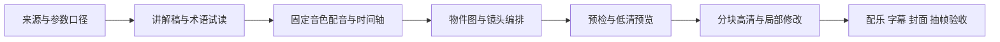

# Anatomy Video

### 把技术资料变成看得懂、能复用的动态讲解视频

面向 GPU、CPU 和计算系统知识讲解的 AI agent skill。输入经过核对的资料与配音稿，输出包含等距物件动画、镜头运动、数据流、配音、字幕、配乐和封面的技术视频。

**[观看 36 秒样片](https://github.com/YangXiaoBo-YG/anatomy-video/releases/tag/camera-flow-demo-v1) · [阅读 Skill](skills/anatomy-video/SKILL.md) · [查看制作规则](skills/anatomy-video/references/视频版规范.md)**

## 这个项目解决什么问题

技术视频的难点不只是画图。数字需要核对口径，物件动作需要解释原理，镜头和字幕需要对齐声音，修改一小段也不应重做整片。Anatomy Video 将这些环节组织成可重复执行的工作流。

| 环节 | 具体做法 | 产出 |
|---|---|---|
| 内容研究 | 核对来源、型号、单位、精度与计算范围 | 参数口径表、解释主线 |
| 视觉解释 | 分层拆解、重点指认、镜头推进与横移、沿连接运动的数据流 | Anatomy SVG 物件与成片页 |
| 配音与字幕 | 固定音色整片合成、术语读音表、读法与显示文字分离 | 音频、字级时间轴、字幕 |
| 制作与验收 | 预检、低清预览、分块高清、局部重渲、抽帧审查 | 可检查、可修改的视频 |

## 看一个完整片段

样片演示一次跨 GPU/CPU 内存路径的读取：请求沿连接推进，经过的部件依次点亮；镜头跟随关键站点移动，最后拉回展示路径与延迟对比。

[下载 / 播放 1080p MP4](showcase/camera-flow/demo.mp4) · [Release 下载页](https://github.com/YangXiaoBo-YG/anatomy-video/releases/tag/camera-flow-demo-v1)

部分结构、布局与机械动作属于解释示意。示例不是 NVIDIA 官方视频。

## 我的工作与上游边界

由 YangXiaoBo-YG 主导选题与制作目标、技术解释方式、镜头和数据流表达、读音规范及成片验收标准，通过人机协作开发脚本和工作流。

底层等距绘图来自 Ryan 的 [Anatomy](https://github.com/wheresryan22/anatomy)：零件几何、四档灰阶、遮挡排序与几何审计。本仓库是其 fork，保留 MIT 许可；上游说明见 [UPSTREAM_README.md](UPSTREAM_README.md)。视频工作流扩展位于 `skills/anatomy-video/`。

## 快速使用

1. 克隆本仓库，按根目录 [Anatomy Skill](SKILL.md) 配置绘图能力。
2. 将 `skills/anatomy-video/` 复制到工作项目的 `.agents/skills/` 或 `.claude/skills/`。
3. 安装 Python、Node.js、FFmpeg 与 Playwright Chromium，运行视频 skill 的 `scripts/doctor.py` 检查环境。
4. 按 [视频 Skill](skills/anatomy-video/SKILL.md) 完成参数核对、新术语试读、配音锁定、预览与渲染。

示例任务：

> 用 anatomy-video 制作一段解释 GPU 显存带宽的浅色等距动画。先核对参数口径，试读新术语，生成低清预览，通过检查后分块渲染。

目前脚本优先适配 Windows / F 盘工作目录，其他环境需要调整路径。配音需要使用者自己的豆包服务权限。

## 从资料到成片

## 仓库导航

| 目录 | 用途 |
|---|---|
| `skills/anatomy-video/` | 你的 agent 应读取的视频工作流 |
| `skills/anatomy-video/scripts/` | 配音、时间轴、检查、渲染、合成工具 |
| `skills/anatomy-video/references/` | 读音表、制作规范、已知问题与验收案例 |
| `skills/anatomy-video/templates/` | 成片页与系列封面模板 |
| `showcase/camera-flow/` | 当前推荐观看的镜头与数据流样片 |
| `showcase/h100/` | H100 早期拆解案例，用于观察迭代 |
| 根目录 `kit/`、`examples/` | 保留的 Anatomy 上游绘图工具与示例 |

## 早期案例

[H100 完整拆解视频](https://github.com/YangXiaoBo-YG/anatomy-video/releases/tag/h100-demo-v1) · [模组样图](showcase/h100/sxm5.png) · [底板拆解样图](showcase/h100/hgx-exploded.png)

## API 与密钥

API 调用实现可以公开，个人密钥不能公开。配音脚本读取环境变量 `VOLC_API_KEY`，仓库不提供有效密钥；不要将密钥写入脚本、截图或 README。`.env`、接口响应、签名下载链接、音频中间产物与个人缓存不应提交。公开示例仅包含已导出的媒体。

## 相关个人项目

[市场风险观察站](https://github.com/YangXiaoBo-YG/market-risk-refresh) · [PhDHunter 博士求职平台](https://github.com/YangXiaoBo-YG/phdhunter-showcase)
