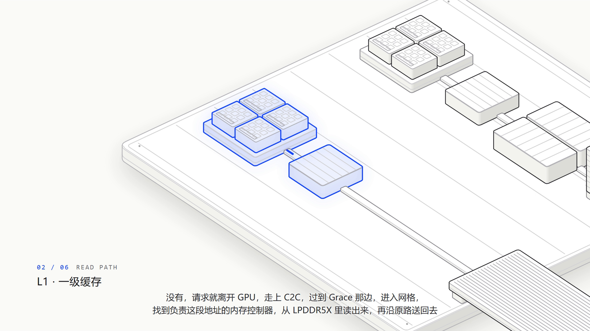
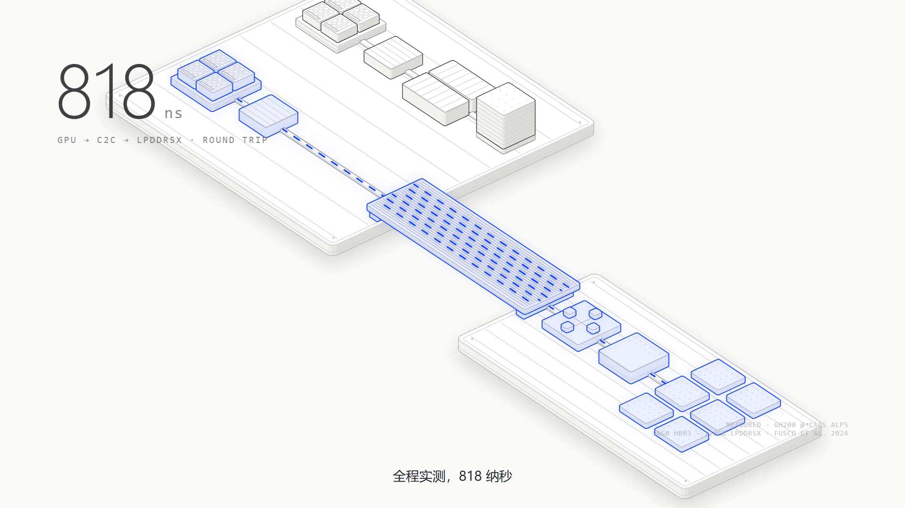
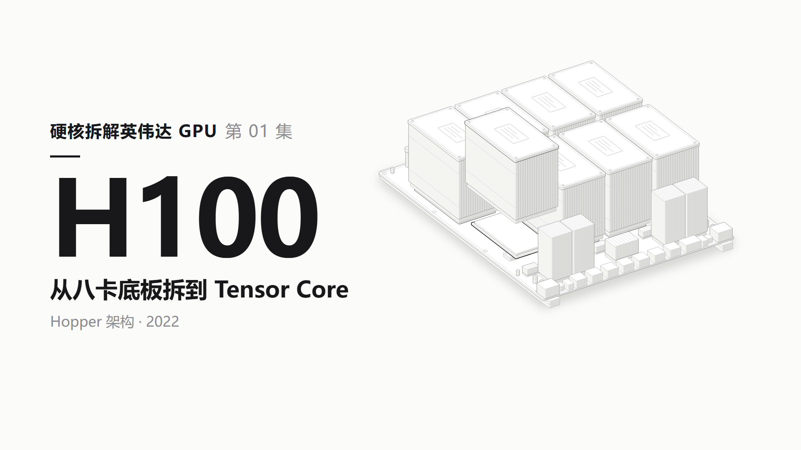
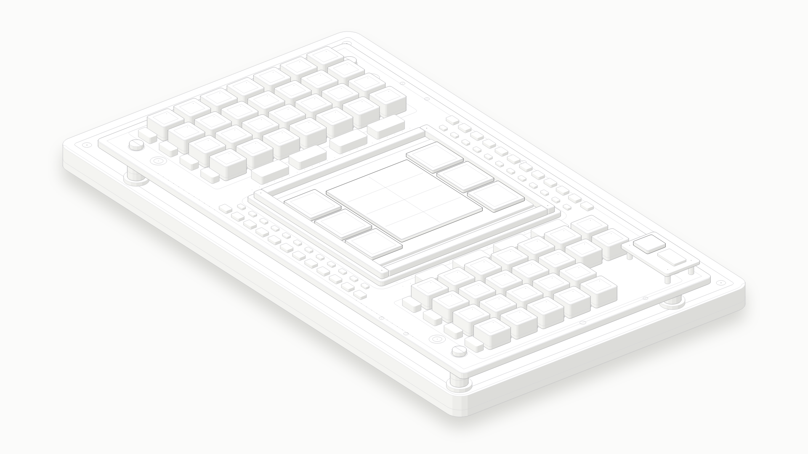
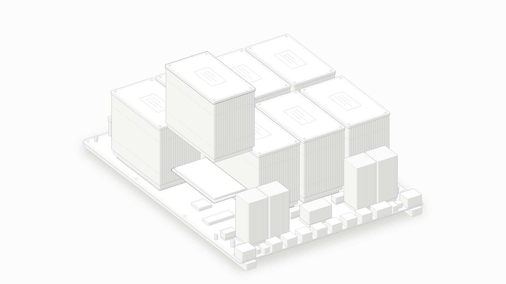

# Anatomy Video · 技术知识视频工作流

基于 [Anatomy](https://github.com/wheresryan22/anatomy) 的视频制作扩展。把技术资料转化为结构准确、因果可见、声画同步的动态讲解视频。

本项目由 YangXiaoBo-YG 主导制作目标、内容表达和验收标准，通过人机协作开发。底层等距绘图工具由 Ryan 的 Anatomy 提供，保留原始 MIT 许可。原项目说明见 [UPSTREAM_README.md](UPSTREAM_README.md)。

## 扩展能力

- 参数来源与口径核对，事实、结构示意和机械类比分开说明。
- 镜头推拉、分层拆解、数据流、旁白对应的部件指认。
- 豆包固定音色整片合成，术语读音表、字级时间轴、字幕显示转换。
- 预检、低清预览、分块渲染、局部重渲、出框和文字检查、抽帧审查。
- 代码合成配乐与响度处理，统一系列封面。

## 使用

将 `skills/anatomy-video` 放进项目的 `.agents/skills/` 或 `.claude/skills/`。根目录的 Anatomy skill 负责物件绘图，视频扩展负责成片流程。

阅读 [视频 skill](skills/anatomy-video/SKILL.md)。需要 Python、Node.js、FFmpeg 和 Chromium；具体环境检测见 `scripts/doctor.py`。目前脚本优先适配 Windows 和 F 盘工作目录，其他系统需调整环境路径。

## 最新视频示例：镜头跟随与数据流

用户选定的 36 秒样片：浅色等距物件图、电光蓝强调，镜头沿读取路径推进和横移，数据经过的站点依次点亮，最后拉回展示路径与延迟对比。

[观看或下载示例视频](https://github.com/YangXiaoBo-YG/anatomy-video/releases/tag/camera-flow-demo-v1) · [仓库内 MP4](showcase/camera-flow/demo.mp4)

## 早期案例：H100

[观看 30 秒早期示例](showcase/h100/demo.mp4) · [完整早期示例](https://github.com/YangXiaoBo-YG/anatomy-video/releases/tag/h100-demo-v1)

示例为非官方技术科普，部分位置、比例和动作采用示意表达；视频中的机械类比不代表芯片内部实物结构。

## API 与隐私

API 调用代码可以公开，个人密钥不能公开。配音脚本只读取本机环境变量 `VOLC_API_KEY`，仓库不提供密钥。不要提交 `.env`、鉴权头、请求或响应日志、签名下载链接、个人配置和缓存。运行时产生的音频、接口结果和中间产物默认忽略。
